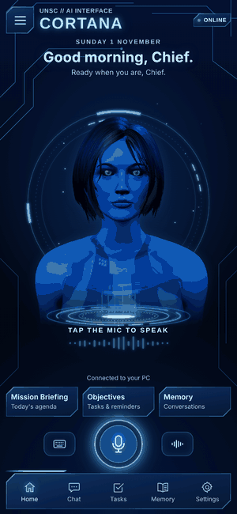
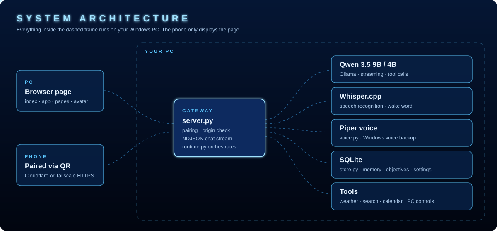
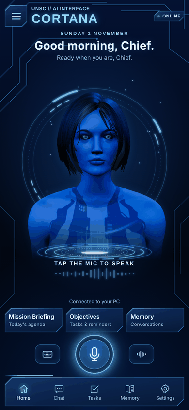
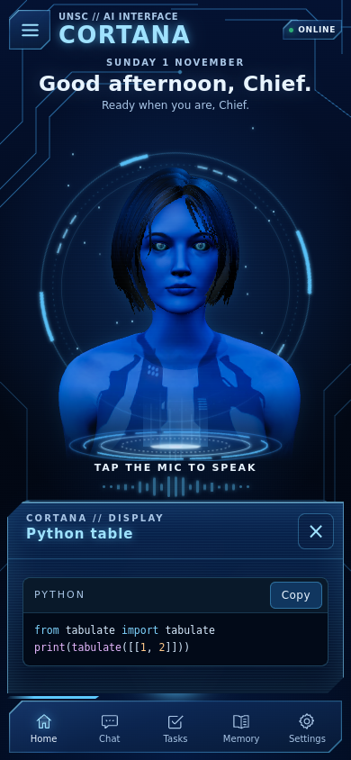
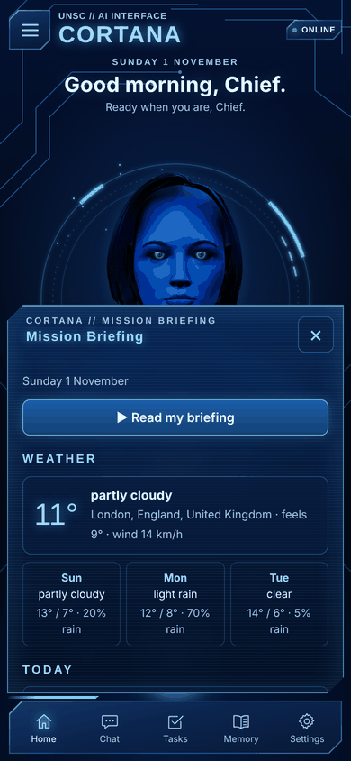
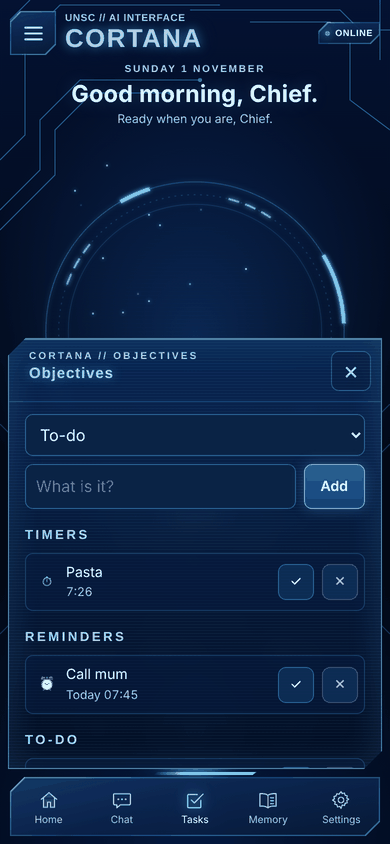
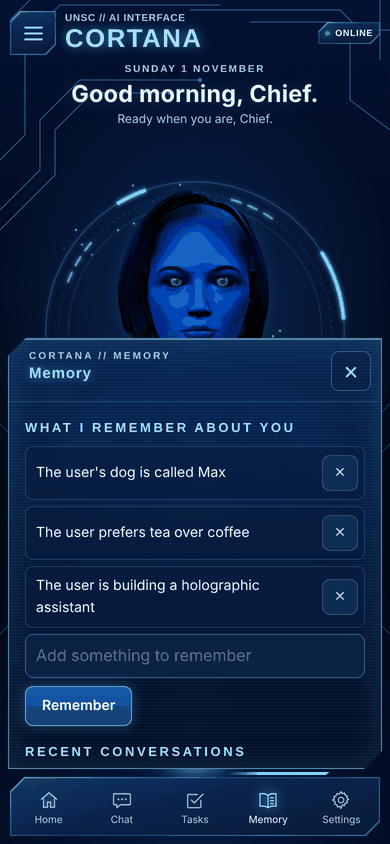
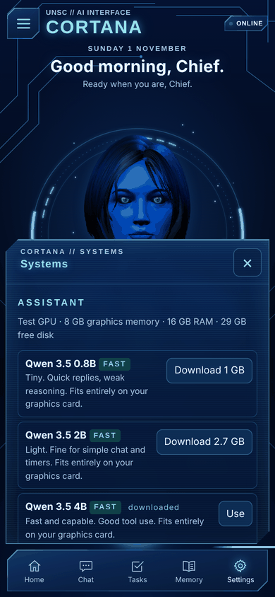

<div align="center">



<br>


<br>


### Your PC is the core. Your phone is the display.

1.5 adds expression/voice setup, saved chat restoration, relevant editable memories, Windows reminders and snooze, and local keyword detection. The reference voice is experimental, slower than Piper, and may skip words. See [release verification](docs/STATUS.md).

**A holographic voice assistant that thinks, listens, speaks and remembers, entirely on your own computer.**<br>
No cloud AI. No subscription. No account. Your conversations never leave your PC.

[**Quick start**](#-quick-start) · [**Features**](#-what-she-can-do) · [**How it works**](#-how-it-works) · [**Docs**](#-documentation) · [**For AI agents**](AGENTS.md)

</div>

---

<table>
<tr>
<td width="42%" align="center">

<br><sub><i>Real interface, recorded with demo data.</i></sub>
</td>
<td width="58%">

### ⚡ At a glance

- 🗣️ **Talk naturally.** Tap the mic or just say *"Hey Cortana"*.
- 🌊 **She answers while she's still thinking.** Replies stream sentence by sentence, with latency depending on your PC and selected voice.
- 🧠 **Smart and private.** Qwen 3.5 runs on your graphics card through Ollama. She **detects your GPU and recommends the best model it can run**, greys out ones that are too big, and downloads your pick with a progress bar.
- 📚 **She works with your PC.** Reads your PDFs, Word docs and slides ("summarise this", "quiz me on chapter 3"), looks at your screen ("what's this error?"), uses your clipboard, finds files, and books calendar events with reminders. All on your PC.
- 🛠️ **She can actually do things:** timers, reminders, a to-do list, long-term memory, weather, web search (no key needed), your calendar, and media/volume/app control on your PC.
- 🖥️ **Holographic display panel.** Code, tables and step-by-step answers slide up on screen instead of being read aloud, with syntax colours and a **Copy** button.
- 📱 **Your phone becomes the screen.** Scan a QR code and the same interface runs on your phone, still powered by your PC.
- 🌀 **A living hologram.** A fully rigged 3D Cortana blinks, looks around, reacts while listening and thinking, and lip-syncs to her voice.
- 🎙️ **PC voices.** Fast Piper, Windows fallback, or the experimental reference voice. Setup offers Normal/Expressive movement and previews. Neural speech uses local audio-aligned mouth cues.

</td>
</tr>
</table>

---

## ✨ What she can do

| | Ability | Say something like… | Where it shows up |
|:-:|---|---|---|
| ⏱️ | **Timers** | *"Set a 10 minute timer for the pasta."* | Objectives page · chime + spoken alert |
| ⏰ | **Reminders** | *"Remind me to call mum at 6pm."* | Objectives page · spoken when due |
| ✅ | **To-do list** | *"Add 'order a keyboard' to my list."* · *"Mark the keyboard as done."* | Objectives page |
| 🧠 | **Long-term memory** | *"Remember my dog is called Max."* · *"Forget about the dog."* | Memory page · used in every answer |
| 🌦️ | **Weather** | *"What's the weather like tomorrow?"* | Mission Briefing |
| 🔎 | **Web search** | *"When was Halo released?"* | Display panel, with sources |
| 📄 | **Read your files** | Drop a PDF/Word/PowerPoint into Chat (📎) · *"Summarise this."* · *"What does the brief say about deadlines?"* · *"Quiz me on chapter 3."* | Chat · Memory → Documents |
| 🖥️ | **See your screen** | *"What's this error on my screen?"* · *"Explain what I'm looking at."* | Spoken + Chat (read by the local Qwen model) |
| 📋 | **Clipboard** | *"Summarise what I just copied."* · *"Fix this code I copied."* · *"Copy that to my clipboard."* | Chat card with **Copy** |
| 🗂️ | **Find files** | *"Where's my coursework PDF from last week?"* · *"Open number 1."* · *"Read number 2."* | Files card |
| 📅 | **Calendar** | *"What's on today?"* · *"Book study time Thursday at 3."* | Mission Briefing · event card with **Add to Google Calendar** · reminder 10 min before every event |
| 🎵 | **PC controls** | *"Pause the music."* · *"Volume up."* · *"Open calculator."* | Acts on your PC (fixed allow-list) |
| 💻 | **Code & tables** | *"How do I build a table in Python?"* | Display panel with **Copy** |
| 🎛️ | **Model picker** | **Systems** → pick from models rated *Fast / Good / Slow / Too big* for your GPU | Recommended model ★, one-click download |
| 📰 | **Daily briefing** | Tap **Mission Briefing → Read my briefing** | Weather, events and objectives, spoken |

> Abilities can be switched off in **Systems** (*Screen, clipboard and file access* has its own switch). She never runs programs, scripts or shortcuts, opens only files she just found for you, and screenshots go only to the AI on your PC.

---

## 🧬 How it works

<div align="center">

<br><br>

</div>

<details>
<summary><b>🔬 The 20-second technical tour</b></summary>
<br>

1. **`launcher.py`** opens a small window, starts a local web server on `127.0.0.1`, and prepares the AI, speech recognition, voice and phone link in the background.
2. **`server.py`** is the only door in. It serves the page, checks every request (local PC, or a phone paired via QR cookie), and blocks cross-site requests and private files.
3. **`runtime.py`** sends your conversation to **Ollama** with a list of **tools**. As the model streams, a sentence splitter turns text into spoken sentences, and anything meant for the eyes (after a `[[SCREEN]]` marker, or any code or table) goes to the display panel instead.
4. **`tools.py`** runs the abilities; **`store.py`** keeps memory, objectives and settings in a local SQLite file.
5. **`voice.py`** keeps **Piper** running, so each sentence takes a fraction of a second, and falls back to the Windows voice if needed.
6. **`app.js`** plays sentences back to back while the next ones are generated; **`avatar.js`** moves the 3D character's jaw, lips, eyes and head from the audio.

Full details: [ARCHITECTURE.md](docs/ARCHITECTURE.md) · [API.md](docs/API.md) · [SPECIFICATION.md](docs/SPECIFICATION.md)
</details>

---

## 📸 Interface

<table>
<tr>
<td align="center"><br><b>Home</b></td>
<td align="center"><br><b>Display panel</b></td>
<td align="center"><br><b>Mission Briefing</b></td>
</tr>
<tr>
<td align="center"><br><b>Objectives</b></td>
<td align="center"><br><b>Memory</b></td>
<td align="center"><br><b>Systems</b></td>
</tr>
</table>
<sub>Screenshots use demo data.</sub>

---

## 🚀 Quick start

> **You need:** Windows 10/11 · an NVIDIA GPU with 8 GB is ideal (it runs on less with the 4B model) · [Ollama](https://ollama.com) (installed automatically if missing) · Chrome or Edge.

### Option A: build the one-file app

```powershell
git clone https://github.com/billyke2000s/cortana-ai.git
cd cortana-ai
python build/build_cortana.py        # installs PyInstaller and dependencies if needed
dist\Cortana.exe
```

### Option B: run from source

```powershell
pip install -r requirements.txt
python app/launcher.py
```

**First launch** asks which AI model to use (each Qwen model is rated for your graphics card, the best fit is marked ★ RECOMMENDED, and ones too big for your PC are disabled), then downloads what's missing and remembers it: Ollama and the chosen model, Whisper (~150 MB), and Piper with a voice (~85 MB). Keep the small Cortana window open while you use her.

<details>
<summary><b>📱 Use it on your phone</b></summary>
<br>

1. Start Cortana on the PC. The window shows a **QR code**.
2. Scan it with your phone camera and open the link.
3. Allow the microphone when asked. Add it to your home screen for an app-like feel.

- **Default:** a temporary Cloudflare HTTPS link. A new QR code appears on each launch.
- **Stable link:** install and sign in to [Tailscale](https://tailscale.com) on the PC and phone, then choose **Systems → Phone connection → Tailscale**.

The QR code grants access to your assistant. Keep it private.
</details>

<details>
<summary><b>🎙️ Use your own voice</b></summary>
<br>

Cortana speaks with [Piper](https://github.com/rhasspy/piper) voices. Pick a stock voice in **Systems**, or train one on **your own recordings** with the included [Voice Trainer](tools/voice-trainer/README.md) (local, GPU):

1. Train and export `en_GB-myvoice-medium.onnx` + `.onnx.json`.
2. Copy both into `%LOCALAPPDATA%\CortanaAI\voices\`.
3. Restart Cortana and choose the voice in **Systems**.

⚠️ Only train on **your own voice, or a voice you have explicit permission to use**. Cloning someone else's voice (including game characters' voice actors) is not supported by this project.
</details>

<details>
<summary><b>📅 Connect your calendar</b></summary>
<br>

Google Calendar → **Settings** → your calendar → **Integrate calendar** → copy **"Secret address in iCal format"** → paste into **Systems → Calendar**. It's read-only, and it's stored only on your PC and never sent back to the page. Treat it like a password.
</details>

---

## 🔐 Privacy & security

| | |
|---|---|
| 🏠 **Local by default** | AI, speech recognition, voice, memory and settings all run and stay on your PC (`%LOCALAPPDATA%\CortanaAI`). |
| 🌐 **What goes online** | Only the abilities you use: weather (Open-Meteo), search (Bing / DuckDuckGo results and the top result page, Wikipedia; no key needed, Brave optional), your calendar address, first-run downloads, and the phone link. |
| 📱 **Phone access** | HTTPS only, paired with a per-launch secret in the QR code (`HttpOnly; Secure; SameSite=Lax` cookie). Unpaired devices see a pairing page. |
| 🛡️ **Hardening** | Origin check on every POST, a fixed whitelist of served files, all AI output HTML-escaped, PC controls limited to a fixed list, files opened only from her own search results (never programs), whole folders addable only on the PC, and secrets never returned by the API. |

Full threat model and rules: [SECURITY.md](SECURITY.md).

---

## 🗂️ Project layout

```text
cortana-ai/
├── app/                    # the application (bundled into Cortana.exe)
│   ├── launcher.py         # entry point: window, QR, starts everything
│   ├── server.py           # HTTP gateway: auth, API, streaming
│   ├── runtime.py          # AI orchestration, streaming, prompt, Ollama/Whisper/tunnel lifecycle
│   ├── tools.py            # abilities the AI can call
│   ├── files.py            # documents, file search, screen and clipboard
│   ├── store.py            # SQLite: settings, memory, objectives, documents, events, conversation log
│   ├── voice.py            # Piper + Windows voice
│   ├── hardware.py         # GPU/RAM detection, model ratings and recommendation
│   ├── speech.ps1          # Windows voice with mouth timings
│   ├── index.html · app.js · pages.js · avatar.js · responsive.css · mic-worklet.js
│   ├── vendor/             # three.js (MIT)
│   └── assets/             # cortana.glb (3D model) + rig.json (bone axes)
├── build/build_cortana.py  # builds dist/Cortana.exe
├── tests/                  # offline suite (no GPU/internet) + live check
├── tools/voice-trainer/    # train a Piper voice from your own recordings
├── docs/                   # full documentation + animated artwork
├── AGENTS.md               # rules for AI coding agents (read before changing anything)
├── SECURITY.md · CHANGELOG.md
└── requirements*.txt
```

---

## 📚 Documentation

| Document | What's inside |
|---|---|
| [**AGENTS.md**](AGENTS.md) | The rulebook for AI coding agents and humans: invariants, contracts, checklists, common mistakes |
| [PROJECT.md](docs/PROJECT.md) | Goals, non-goals, principles |
| [SPECIFICATION.md](docs/SPECIFICATION.md) | Exactly how every feature behaves |
| [ARCHITECTURE.md](docs/ARCHITECTURE.md) | Components, threads, data flow, startup, storage |
| [API.md](docs/API.md) | Every HTTP endpoint and stream event |
| [DEVELOPMENT.md](docs/DEVELOPMENT.md) | Setup, running from source, building, conventions, how-tos |
| [TESTING.md](docs/TESTING.md) | Offline suite, live check, manual checklist |
| [SECURITY.md](SECURITY.md) | Threat model and security rules |
| [STATUS.md](docs/STATUS.md) | What's done, what's verified, known issues, roadmap |
| [DECISIONS.md](docs/DECISIONS.md) | Why things are the way they are (decision records) |
| [CHANGELOG.md](CHANGELOG.md) | History |

---

## 🧪 Tests

```bash
python -m unittest discover -s tests -v     # 80 offline tests, about 3 seconds, no GPU or internet needed
```

They cover the sentence streamer, storage, every tool, model recommendations, calendar parsing, the whole HTTP API (streaming chat with tool calls, objectives, memory, settings) and the security rules, including a regression test for phone QR pairing. See [TESTING.md](docs/TESTING.md).

---

## 🤖 Working on this with an AI?

Point it at **[AGENTS.md](AGENTS.md)** first. It's a strict rulebook (security invariants, API contracts, a file map, step-by-step checklists for every kind of change, and a list of mistakes already made once) written so an AI assistant can change this project without breaking it. `CLAUDE.md`, `GEMINI.md` and `.github/copilot-instructions.md` all point there.

---

## 🙏 Credits & disclaimer

- **AI:** [Qwen 3.5](https://qwenlm.github.io/) via [Ollama](https://ollama.com) · **Speech recognition:** [whisper.cpp](https://github.com/ggml-org/whisper.cpp) · **Voice:** [Piper](https://github.com/rhasspy/piper) · **3D:** [three.js](https://threejs.org) (MIT) · **Weather:** [Open-Meteo](https://open-meteo.com) · **QR:** python-qrcode · **PDF text:** [pypdf](https://github.com/py-pdf/pypdf) (BSD-3-Clause) · **Phone link:** Cloudflare Quick Tunnels / Tailscale.
- **CPU speech:** [sherpa-onnx](https://github.com/k2-fsa/sherpa-onnx) / [ZipVoice](https://github.com/k2-fsa/ZipVoice) (Apache-2.0), [Vocos](https://github.com/gemelo-ai/vocos) (MIT), [Rhubarb Lip Sync](https://github.com/DanielSWolf/rhubarb-lip-sync) (MIT). Voice notices are bundled; downloaded distributions retain their notices.
- **Cortana**, **Halo**, **UNSC** and **Master Chief** are trademarks of Microsoft. This is an unofficial, non-commercial fan project, not affiliated with or endorsed by Microsoft, 343 Industries or Bungie.
- **Repository visibility:** GitHub reported this repo public on 1 November 2026. This release does not change visibility. It contains the supplied character model and reference profile; see AGENTS.md for contributor restrictions.
- **Licence:** none has been chosen yet, so by default all rights are reserved by the author. Add a `LICENSE` file to change that.

<div align="center"><br><sub>Built with an unreasonable amount of blue glow.</sub></div>
