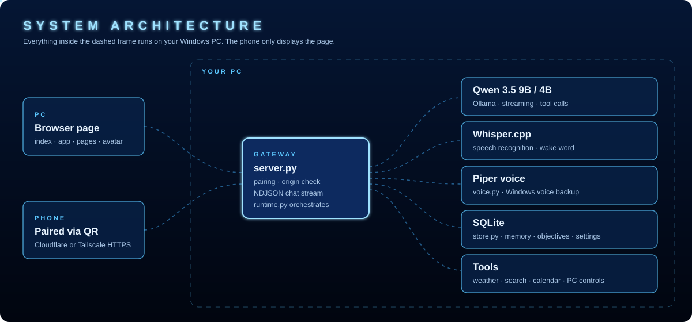

# Architecture



## Overview

Cortana is a **local web app with a desktop launcher**. One Windows process (`Cortana.exe`, or `python app/launcher.py`)
hosts everything: a Tk window, an HTTP server bound to `127.0.0.1`, and background threads that manage the AI (Ollama),
speech recognition (whisper.cpp), the voice (Piper / Windows SAPI), storage (SQLite) and an optional phone tunnel.
The interface is a static HTML/JS page served by that process and opened in the user's browser, or on a paired phone.

```text
Browser / phone ──HTTPS tunnel (phone only)──┐
                                             ▼
                              server.py  (ThreadingHTTPServer, 127.0.0.1)
                                  │ auth · whitelist · /api/*
                                  ▼
                              runtime.py (Runtime)
            ┌──────────────┬──────┴───────┬──────────────┬──────────────┐
         Ollama        whisper-cli     voice.py        store.py       tools.py
      (qwen3.5 9B/4B)  (transcribe)   Piper/SAPI       (SQLite)    weather/search/
       HTTP :11434      subprocess    subprocess                   calendar/PC/...
```

## Processes and threads

| Thread / process | Started by | Lifetime | Purpose |
|---|---|---|---|
| Main thread | `launcher.main` | app | Tk window, QR rendering, event polling (`window.after`) |
| HTTP server thread | `launcher.main` | app | `server.serve_forever()`; each request gets its own thread (`ThreadingHTTPServer`, daemon) |
| Startup thread | `launcher.main` | until ready | `ensure_ai()` → `ensure_stt()` → `start_tunnel()` |
| Voice prepare thread | startup | short | `voice.prepare()`: download Piper + voice, start Piper |
| `ollama serve` | `Runtime.spawn` (only if not already running) | app | LLM server |
| `piper.exe --json-input` | `Voice._process` | app (restarted on voice/rate change) | sentence synthesis |
| `cloudflared` | `start_tunnel` | app | phone HTTPS link (Cloudflare mode) |
| `whisper-cli.exe` | `transcribe()` | per request | speech to text |
| `powershell speech.ps1` | `Voice.windows` | per request | Windows voice fallback |

All long-running children are registered in `runtime.children` and terminated by `Runtime.close()` when the window closes.
An Ollama instance that was already running before launch is left running.

## Startup sequence

1. `Runtime()` creates the data folder and opens `cortana.db`, chooses the model (`CORTANA_MODEL` → setting → the hardware recommendation made in `ensure_ai()`),
   and creates the pairing token (persistent only in Tailscale mode).
2. `AppServer` binds `127.0.0.1` (random port; fixed port 47817 in Tailscale mode); the URL is written to `launch-state.json`.
3. Background: voice preparation starts in its own thread; then `ensure_ai()` (find/start/download Ollama, pull the model if
   missing, fall back to 4B, preload with `num_ctx=6144`), `ensure_stt()` (download whisper.cpp v1.8.2 + `ggml-base.en.bin`),
   `start_tunnel()` (Tailscale if chosen and available, else Cloudflare Quick Tunnel).
4. The browser opens the local URL. The page polls `/api/status` every 4 s.

Errors in startup set `runtime.error`, are shown in the window and page, and the traceback goes to `startup-error.log`.

## Request flow: one spoken question

1. **Mic:** `app.js listen()` captures audio through `mic-worklet.js`, stops after ~1.2 s of silence, encodes 16 kHz mono WAV, then `POST /api/transcribe` → `whisper-cli`.
2. **Chat:** `send(text)` → `POST /api/chat-stream` with the last ≤18 messages.
3. **Runtime:** `chat_stream()` builds `[system_prompt(store)] + history`, calls Ollama `/api/chat` with `stream: true`, `think: false`, `tools: TOOLS`, `num_ctx: 6144`.
   - Content tokens go through `SpokenStream.feed()` → whole sentences → `sentence` events.
   - Tool calls → `tools.run()` → `tool` (+ `refresh`) events → results appended as `role: tool` → next round (max 4 rounds).
   - At the end: optional `screen` event, then `done`. The exchange is logged to SQLite.
4. **Voice:** each `sentence` is immediately sent to `POST /api/speech` (`SpeechQueue.add`); the server synthesises with Piper (one process, serialised by a lock). The client schedules buffers back to back on the `AudioContext` clock.
5. **Lip sync:** cues come from SAPI visemes (Windows voice) or `envelopeCues()` (loudness + zero-crossing for Piper), shifted to the shared timeline; `avatar.js` blends mouth poses per frame.
6. **Display:** a `screen` event renders Markdown (escaped first) into the holographic panel.

GPU/RAM detection and model ratings live in `hardware.py` (see D-019); `GET /api/models` exposes them to the Systems page.

## Storage

`%LOCALAPPDATA%\CortanaAI\` (or `CORTANA_DATA_DIR`):

| Path | Contents |
|---|---|
| `cortana.db` (+ `-wal`, `-shm`) | SQLite: `settings`, `facts` (≤200), `messages` (≤2000), `items` (timers/reminders/tasks) |
| `ollama/`, `ollama.log` | Ollama runtime if the app had to download it |
| `whisper/`, `ggml-base.en.bin` | Speech recognition |
| `piper/`, `voices/`, `piper.log`, `speech-tmp/` | Voice engine, voice models, temporary WAVs |
| `cloudflared.exe` | Tunnel client |
| `launch-state.json`, `startup-error.log` | Diagnostics |

Schema (see `app/store.py`): `items(kind ∈ {timer, reminder, task}, text, due REAL|NULL, done, announced, created)`.
Alerts = `done=0 AND announced=0 AND due<=now`. Timers are completed when announced; reminders stay open until completed.

## Frontend structure

- `index.html`: layout (header, greeting, hologram stage, transcript, tiles, controls, nav, dialogs). Loads modules in order: `avatar.js` → `app.js` → `pages.js`.
- `app.js`: state machine (`idle | listening | thinking | speaking`), streaming reader, `SpeechQueue`, mic, wake word, alerts, display panel and Markdown renderer, navigation.
- `pages.js`: pages rendered inside the display panel; listens for `cortana:refresh`.
- `avatar.js`: three.js scene; `CortanaAvatar.startSpeech(cues, clock, duration)` + `extendSpeech(duration)`; texture validation and retry; context-loss recovery.
- `responsive.css`: phone-first overrides; panel and page styles.

## Phone access

- **Cloudflare (default):** `cloudflared tunnel --url http://127.0.0.1:PORT` gives `https://<random>.trycloudflare.com`. Token is new each launch.
- **Tailscale (optional):** `tailscale serve --bg PORT` on a fixed port; the phone URL is `https://<pc>.<tailnet>.ts.net`; token persists. **[Unverified]** on real hardware.
- Pairing: QR encodes `https://HOST/?pair=TOKEN` → server sets `cortana_session` cookie (`HttpOnly; Secure; SameSite=Lax; Max-Age=30 days`) → redirect to `/`.

## Build

`build/build_cortana.py` runs PyInstaller `--onefile --windowed` on `app/launcher.py`, bundling the web files, `assets/`,
`vendor/`, hidden imports (`store`, `tools`, `voice`, `qrcode`, `dateutil`, `tzdata`) and tzdata's zone files. At runtime
`RESOURCES` points at PyInstaller's `_MEIPASS` (or `app/` from source).
